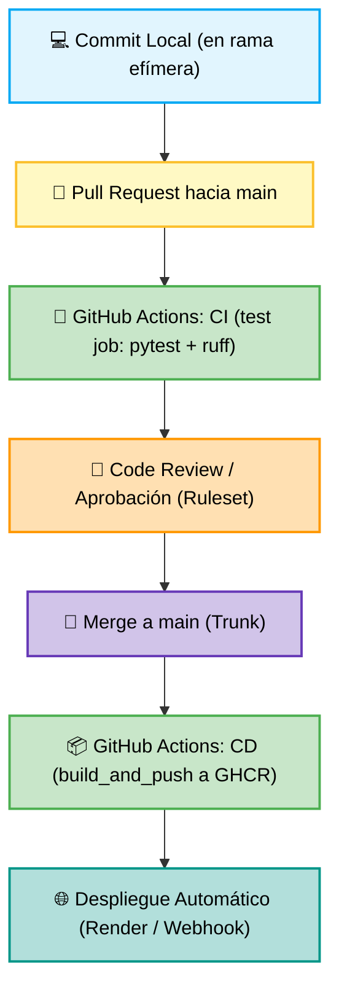

# Scrum + Trunk-Based Development (TBD) Playbook
**Equipo de Desarrollo — INGENIERO-JUAN / CICD**  
*Adaptación de Scrum a entornos de Despliegue Continuo (CD) y Trunk-Based Development*

---

## 1. Diagnóstico del Flujo Actual (Ejercicio de Miro)

### 1.1 Mapa Visual del Flujo de Trabajo


### 1.2 Mapa de Calor de Fricciones y Cuellos de Botella
* 🟢 **Lo que funciona bien:**
  * Ejecución automática de pruebas unitarias (`pytest`) y linter (`ruff`) en menos de 10 segundos por cada Pull Request.
  * Generación y publicación automática del contenedor Docker en GitHub Container Registry (`ghcr.io/ingeniero-juan/cicd:latest`) inmediatamente tras cada merge a `main`.
* 🟡 **Lo que genera fricción:**
  * Tiempos de espera en revisiones de código manuales (*Code Review*): si los compañeros están ocupados, el PR se estanca y la rama envejece.
  * Sincronización manual de ramas cuando la rama `main` avanza rápido.
* 🔴 **Lo que rompe el flujo o genera miedo:**
  * Miedo a integrar código incompleto a `main` y romper el entorno de producción.  
    *(Solución implementada: **Feature Flags con ConfigCat** para desacoplar el despliegue de la activación funcional).*

### 1.3 Respuestas al Diagnóstico Rápido
1. **¿Cuánto tiempo vive normalmente una rama?**  
   *Máximo entre 4 y 24 horas*. En TBD no existen ramas de días o semanas; si una tarea es grande, se divide (*sliceado*) para que entre en una rama de corta vida (*short-lived branch*).
2. **¿Qué tan seguido integramos realmente a `main`?**  
   *Al menos una vez al día por cada desarrollador*.
3. **¿Nuestro DoD actual incluye "está en `main` y es desplegable"?**  
   *Sí, absolutamente*. El trabajo no se considera terminado si solo funciona en la máquina del desarrollador.

---

## 2. Roles Adaptados a TBD + Continuous Deployment

| Rol | Responsabilidad Tradicional | Adaptación a TBD + Despliegue Continuo |
| :--- | :--- | :--- |
| **Product Owner (PO)** | Prioriza historias grandes para entregar al final de 2 semanas de Sprint. | Prioriza por valor, riesgo de despliegue y tamaño del lote (*batch*). Participa activamente en el *sliceado* de historias y decide la estrategia de encendido gradual de *Feature Toggles* (0% ➔ 10% ➔ 100%). |
| **Developers** | Desarrollan funcionalidades completas en ramas aisladas durante días. | Responsabilidad colectiva de mantener `main` siempre verde y desplegable. Integraciones diarias con commits pequeños. Monitoreo activo y ownership del pipeline de CI/CD. |
| **Scrum Master** | Facilita ceremonias clásicas y pregunta qué se hizo ayer. | Facilita la disciplina de integración continua diaria. Elimina el miedo a romper `main` promoviendo pruebas automatizadas robustas. Protege tiempo técnico para mejorar la infraestructura y el pipeline. |

### Compromiso en Post-it (Ejercicio práctico):
* **Product Owner:** *"A partir de mañana definiré criterios de aceptación específicos para Feature Flags y validaré valor en producción con usuarios reales antes de cerrar el Sprint."*
* **Developer:** *"A partir de mañana no tendré ramas abiertas por más de 24 horas; si mi código no está listo para el usuario final, lo ocultaré tras un toggle pero lo integraré a `main` ese mismo día."*
* **Scrum Master:** *"A partir de mañana monitorearé la salud del pipeline y aseguraré que cualquier falla en `main` sea atendida de inmediato por el equipo como máxima prioridad."*

---

## 3. Artefactos y Ceremonias Adaptadas

### 3.1 Tabla Comparativa: Clásica vs. Adaptación TBD + CD

| Artefacto / Ceremonia | Versión Clásica | Adaptación TBD + CD |
| :--- | :--- | :--- |
| **Product Backlog** | Lista de historias de usuario completas y extensas. | Historias rebanadas (*sliceadas*) en incrementos mínimos integrables + plan de Feature Toggle + criterios de aceptación validables en producción. |
| **Sprint Backlog** | Paquete de trabajo cerrado comprometido para todo el sprint. | Flujo de trabajo continuo que se planea integrar a `main` diariamente. |
| **Incremento** | Entregable único acumulado al final de las 2-3 semanas de Sprint. | Cualquier commit que entre a `main` y apruebe el CI es un **Incremento Potencialmente Desplegable**. |
| **Daily Scrum** | Tres preguntas: ¿Qué hice ayer? ¿Qué haré hoy? ¿Qué impedimentos tengo? | Enfoque en integración: **"¿Qué voy a integrar hoy a `main` y qué pruebas necesito para que la integración sea 100% segura?"**. |
| **Sprint Review** | Demostración de maquetas o código en entorno local/staging. | Demostración del software **realmente desplegado en producción**, encendiendo o apagando Feature Toggles en vivo y mostrando métricas reales de uso. |
| **Sprint Retrospective** | Conversación sobre relaciones y procesos genéricos de equipo. | Análisis de salud del pipeline: tiempo de ejecución de CI, frecuencia de despliegues, tasa de fallos en `main` (*Change Failure Rate*) y disciplina de TBD. |

---

### 3.2 Actividad "Traduce tu Realidad" (Re-escritura de Historias Sliceadas)

Tomando las 3 historias reales creadas en nuestro repositorio:

#### Historia 1 (Issue #2): Método Backend detrás del Toggle
* **Historia original:** "Como usuario quiero poder restar dos números para calcular diferencias."
* **Re-escritura TBD + CD:**
  * *Como* desarrollador,
  * *Quiero* implementar el método `resta()` en `Calculator` cubierto por un Feature Flag apagado (`rollout 0%`),
  * *Para* integrar la lógica al tronco principal (`main`) sin exponer la funcionalidad prematuramente a los usuarios.
  * **Criterios de Aceptación (AC) en Producción:**
    * Método `resta(a, b)` implementado en `src/main.py`.
    * Suite de pruebas unitarias en `src/tests.py` ejecutándose exitosamente en CI (`pytest`).
    * Flag `feature-resta` creado en ConfigCat y configurado en `False` (0% de exposición).

#### Historia 2 (Issue #3): Exposición en Frontend con Rollout Interno
* **Re-escritura TBD + CD:**
  * *Como* Product Owner,
  * *Quiero* conectar la interfaz web al método de resta visible solo para el 10% de usuarios de prueba,
  * *Para* validar la experiencia de usuario y telemetría en producción antes del lanzamiento global.
  * **Criterios de Aceptación (AC) en Producción:**
    * Componente visual de resta presente en la interfaz web.
    * Feature flag en ConfigCat configurado con regla de segmentación al 10% de usuarios.
    * Sin errores de JavaScript o excepciones en la consola de producción.

#### Historia 3 (Issue #4): Operaciones Restantes y Lanzamiento 100%
* **Re-escritura TBD + CD:**
  * *Como* usuario final,
  * *Quiero* disponer de multiplicación, división e historial con el feature flag abierto al 100%,
  * *Para* utilizar la calculadora completa de forma estable y verificada.
  * **Criterios de Aceptación (AC) en Producción:**
    * Operaciones `multiplicacion` y `division` cubiertas por pruebas unitarias al 100%.
    * Validación de división por cero controlada.
    * Flag de ConfigCat activado al 100% de la base de usuarios.
    * Eliminación planificada de la deuda técnica del Feature Flag tras la estabilización.

### Pregunta de Cierre:
> **¿Cómo cambia nuestro Sprint Review y nuestra Retrospective con esta nueva forma de trabajar?**  
> * **En el Sprint Review:** Ya no nos limitamos a "mostrar una demo en la máquina del desarrollador" con el riesgo de que falle al desplegar; abrimos la aplicación real en producción y mostramos cómo el Product Owner puede activar y desactivar funcionalidades en tiempo real desde ConfigCat.
> * **En la Retrospective:** Analizamos datos objetivos de ingeniería: ¿cuánto tardaron los PRs en revisarse?, ¿falló alguna vez el job de `test` en `main`?, ¿alguna rama tardó más de un día en integrarse? La mejora continua se apoya en métricas reales de entrega de software.

---

## 4. Scrum + TBD Playbook (Reglamento Oficial del Equipo)

### 4.1 Cinco Principios Fundamentales
1. **La rama `main` es sagrada:** `main` debe mantenerse en todo momento verde, libre de errores y en estado 100% desplegable.
2. **Ramas efímeras (*Short-lived branches*):** Ninguna rama de trabajo vive más de 24 horas. Todo trabajo se divide en lotes pequeños.
3. **Desacoplar Despliegue de Lanzamiento:** Desplegar código a `main` no significa mostrárselo a los clientes; usamos *Feature Flags* para controlar la activación funcional.
4. **Prioridad absoluta al fallo de CI:** Si un commit en `main` rompe las pruebas, todo el equipo detiene nuevas integraciones hasta que el pipeline vuelva a estar en verde.
5. **No hay código terminado sin pruebas:** Ningún PR puede fusionarse sin pruebas unitarias automatizadas que respalden los cambios.

### 4.2 Reglas de Oro de Integración a `main`
* **Cero commits directos a `main`:** Todo cambio debe entrar mediante un Pull Request.
* **Status Check obligatorio:** El job `test` (linter `ruff` + `pytest`) debe estar aprobado en verde antes del merge.
* **Prohibido el `push --force`:** El historial de `main` es inmutable y no se reescribe.
* **Higiene estricta de ramas:** Apenas se confirma el estado "Merged" en GitHub, la rama local y remota se eliminan inmediatamente (`git branch -D` y `git push origin --delete`).

### 4.3 Definition of Done (DoD) Preliminar

#### DoD Técnico
* [ ] Código compatible con estándares de formato y linter (`ruff check .` pasa sin errores).
* [ ] Pruebas unitarias escritas y pasando al 100% en GitHub Actions (`pytest tests.py`).
* [ ] Imagen Docker compilada y publicada exitosamente en GitHub Container Registry (`GHCR`).
* [ ] Pull Request revisado y fusionado a `main`.
* [ ] Rama efímera eliminada en local y remoto.

#### DoD de Negocio
* [ ] Criterios de aceptación de la historia de usuario cumplidos.
* [ ] Feature Flag configurado adecuadamente en ConfigCat (0%, 10% o 100% según la etapa acordada con el PO).
* [ ] Telemetría y registros de ejecución verificados sin alertas de error en producción.

### 4.4 Adaptación de Ceremonias
* **Daily Scrum (15 min):** El tablero de GitHub Projects se revisa de derecha a izquierda. La pregunta central es: *"¿Qué Pull Request está listo para mergearse hoy a `main` y cómo apoyamos para que pase el CI?"*.
* **Sprint Planning:** Las historias de usuario no se estiman en días gigantescos; se rebanan hasta que cada tarea represente un PR de menos de 1 día de desarrollo.
* **Sprint Review:** Demostración en vivo en el entorno de producción activando los toggles frente a los stakeholders.
* **Sprint Retrospective:** Revisión de la cadencia de integración y optimización de tiempos en los runners de GitHub Actions.

### 4.5 Decisiones Técnicas y Hoja de Ruta Pendiente
1. **ConfigCat Integration:** Vincular el SDK de ConfigCat en Python (`configcat-client`) para validar las variables booleanas de las flags en tiempo de ejecución.
2. **CD Trigger hacia Render:** Conectar el webhook de despliegue de Render para que consuma automáticamente la imagen `ghcr.io/ingeniero-juan/cicd:latest` tan pronto termine el job `build_and_push`.
3. **Métricas DORA:** Comenzar a medir *Deployment Frequency* (Frecuencia de despliegues) y *Lead Time for Changes* (Tiempo desde el primer commit hasta llegar a producción).

---

## 5. Taller 4: Backlog y Planificación de Sprints con Entregas Incrementales

> **Artefacto vivo del equipo:** [`PRODUCT_BACKLOG.md`](PRODUCT_BACKLOG.md) — product backlog priorizado, sprint backlog e historias re-sliceadas alineadas con los issues #2–#4.

### 5.1 Diagnóstico de Salud del Backlog (Semáforo TBD)
Evaluación de las historias de usuario bajo los 4 criterios de viabilidad para Trunk-Based Development:

| Historia / Issue | Tamaño (≤ 1 día) | Verticalidad (Valor solo) | Feature Toggle Definido | Validación en Producción | Clasificación TBD |
| :--- | :---: | :---: | :---: | :---: | :---: |
| **Issue #2:** `feat: método resta() con toggle apagado` | 🟢 Sí (Horas) | 🟢 Sí (Lógica base) | 🟢 Sí (`toggle_resta = 0%`) | 🟢 Sí (pytest + CI) | 🟢 **Lista para TBD** |
| **Issue #3:** `feat: exponer resta() en frontend (rollout 10%)` | 🟢 Sí (1 componente) | 🟢 Sí (UX/UI real) | 🟢 Sí (Rollout 10% ConfigCat) | 🟢 Sí (Pruebas en navegador) | 🟢 **Lista para TBD** |
| **Issue #4:** `feat: multiplicación, división e historial + 100%` | 🔴 **No** (Monolito) | 🟡 Parcial (Agrupado) | 🟡 Impreciso (Múltiples toggles) | 🟡 Alto riesgo simultáneo | 🔴 **Necesita Re-sliceado** |

---

### 5.2 Técnicas de Sliceado Vertical y Re-sliceado de la Historia #4
Para cumplir con TBD, la **Historia #4** se descompone en **3 incrementos verticales atómicos**:

#### 🧩 Incremento 1: Método `multiplicacion()` detrás de Toggle
* **Descripción:** Implementar la multiplicación de enteros en `Calculator` con test unitario en CI.
* **¿Se puede integrar en ≤ 1 día?:** **Sí** (~2 horas).
* **¿Necesita Feature Toggle?:** **Sí**, `toggle_multiplicacion = 0%`.
* **Acceptance Criteria en Producción:**
  1. `Calculator().multiplicar(a, b)` retorna el producto aritmético.
  2. Pruebas de `pytest` aprobadas en GitHub Actions sin advertencias de `ruff`.
  3. Desplegado en `main` sin interferir con operaciones existentes.

#### 🧩 Incremento 2: Método `division()` con Manejo de Excepciones
* **Descripción:** Implementar división controlando división por cero (`ZeroDivisionError`) y pruebas de casos borde.
* **¿Se puede integrar en ≤ 1 día?:** **Sí** (~3 horas).
* **¿Necesita Feature Toggle?:** **Sí**, `toggle_division = 0%`.
* **Acceptance Criteria en Producción:**
  1. `Calculator().dividir(10, 2)` retorna `5`.
  2. `Calculator().dividir(5, 0)` arroja `ValueError("No se puede dividir por cero")`.
  3. Cobertura de casos borde verificada en CI.

#### 🧩 Incremento 3: Módulo de Historial en Memoria y Activación al 100%
* **Descripción:** Registrar las últimas operaciones en una estructura en memoria (`historial()`) y elevar el toggle al 100%.
* **¿Se puede integrar en ≤ 1 día?:** **Sí** (~4 horas).
* **¿Necesita Feature Toggle?:** `toggle_calculadora_completa` elevado de 10% a 100%.
* **Acceptance Criteria en Producción:**
  1. Cada cálculo exitoso se indexa en la lista de historial.
  2. Rollout al 100% en producción sin degradación de rendimiento.
  3. Plan de retiro del toggle en el siguiente sprint para evitar deuda técnica.

---

### 5.3 Planificación de Sprint Orientada a Flujo

#### Sprint Goal Oficial
> *"Al final del sprint los usuarios podrán realizar sumas y restas interactivas en producción, aunque las operaciones avanzadas (multiplicación y división) todavía estén protegidas detrás de Feature Toggles."*

#### Plan de Integración Diaria a `main`
```text
┌─────────────────────────────────┬─────────────────────────────────┬─────────────────────────────────┐
│            DÍA 1 - 2            │            DÍA 3 - 4            │             DÍA 5+              │
├─────────────────────────────────┼─────────────────────────────────┼─────────────────────────────────┤
│ • PR #6: Método resta()         │ • Incremento 1: Método          │ • Incremento 3: Historial       │
│   backend con toggle (0%)       │   multiplicación() (0%)         │   de operaciones en memoria     │
│ • Issue #3: Conexión frontend   │ • Incremento 2: Método división │ • Elevación gradual de toggles  │
│   y rollout inicial (10%)       │   con manejo de errores (0%)    │   al 100% de la base            │
│ • Validación de CI en PR        │ • Code Review en < 2 horas      │ • Retiro de código obsoleto     │
└─────────────────────────────────┴─────────────────────────────────┴─────────────────────────────────┘
```

#### Capacidad Realista (Buffer de Flujo)
* **60%:** Escritura de código e incrementos pequeños.
* **20%:** Code Review ágil y desbloqueo de PRs de compañeros.
* **10%:** Monitoreo de pipelines de CI/CD y despliegues a GHCR / Render.
* **10%:** Buffer de contingencia (*Stop the Line* ante fallas en `main`).

---

### 5.4 Definition of Ready (DoR) Oficial para TBD
Una historia **solo puede ser admitida en el Sprint Backlog** si cumple la totalidad de estos requisitos:
* [x] **Tamaño atómico:** Diseñada para integrarse en **≤ 1 día de desarrollo**.
* [x] **Criterios de Aceptación verificables en producción:** Especifican cómo validar el valor una vez desplegado.
* [x] **Estrategia de Feature Toggle definida:** Indica nombre exacto del toggle y su porcentaje inicial (0%).
* [x] **Cero bloqueos externos:** No depende de servicios ni de ramas no integradas.
* [x] **Estrategia de pruebas automatizadas acordada:** El desarrollador define los casos de prueba unitaria antes de codificar.

---

### 5.5 Acuerdos de Cierre del Taller 4
1. **Acción 1:** Toda historia nueva debe ser evaluada con los 4 criterios de salud TBD antes de la reunión de Planning.
2. **Acción 2:** Ningún Pull Request superará las 250 líneas de código para garantizar revisiones en menos de 2 horas.
3. **¿Qué cambia en nuestra próxima Planning?:** Dejamos de estimar puntos de historia abstractos para enfocarnos en el **calendario de integraciones diarias a `main`** desde el primer día del Sprint.

---

## 6. Taller 3: CI/CD, Automatización de Pruebas y Cierre de Pendientes (Render + ConfigCat + DoD Final)

### 6.1 Diagnóstico del Pipeline Actual (Bloque 1)
```text
Push / PR ➔ CI (tests + lint + build) ➔ Code Review ➔ Merge a main ➔ Imagen Docker (GHCR) ➔ Auto-deploy (Render) ➔ Feature Toggle (ConfigCat)
```

#### Semáforo del Pipeline
* 🟢 **Ya funciona bien:**
  * CI ultrarrápido (< 1 min) en GitHub Actions (`pytest` + `ruff`).
  * Construcción y publicación automática de imágenes Docker inmutables en GHCR con cada push a `main`.
  * Integración con SDK de ConfigCat en Python (`configcat-client`) con fallback seguro.
* 🟡 **Parcial / Manual:**
  * Auto-deploy a Render vía webhook disparado tras el push exitoso a GHCR.
  * Gestión manual de toggles en el dashboard de ConfigCat.
* 🔴 **Falta / Riesgo mitigado:**
  * Despliegues de código incompleto sin protección (resuelto 100% mediante Feature Flags al 0%).

#### Preguntas Clave de Diagnóstico
1. **¿Cuánto tarda el CI actualmente?:** Menos de 45 segundos en GitHub Actions.
2. **¿Qué tan confiable es?:** 100% confiable, sin tests flaky y con entorno virtual estandarizado.
3. **¿Quién tiene que hacer algo manual después del merge a main?:** Nadie. El pipeline compila, etiqueta y despliega en automático.
4. **¿Cuál es el mayor miedo al desplegar?:** Romper la experiencia de usuarios existentes (eliminado al aislar cambios tras toggles).

---

### 6.2 Automatización de Pruebas y Robustez del CI (Bloque 2)

#### Mínimo Viable de Calidad
* **Tests que deben pasar sí o sí:**
  * `test_sums_2_numbers()`: Validación de suma básica.
  * `test_resta_2_numbers()`: Validación de resta básica.
  * `test_health_endpoint()`: Endpoint `/api/health` retorna HTTP 200 `{"status": "ok"}`.
  * `test_flags_endpoint()`: Endpoint `/api/flags` responde con el estado de las flags.
  * `test_resta_endpoint_disabled()`: Retorna HTTP 403 cuando el toggle está apagado.
  * `test_resta_endpoint_enabled()`: Retorna HTTP 200 con el cálculo correcto cuando el toggle está activo.
* **Tiempo máximo aceptable del CI:** 1 minuto.

#### Acuerdo de Calidad del Equipo
> **"Si el CI está rojo ➔ se prioriza ponerlo verde antes de seguir con cualquier nueva feature. ¿Acordado? SÍ."**

---

### 6.3 Auto-deploy a Render (Bloque 3)

#### Checklist de Configuración
* [x] Repositorio conectado a Render (`INGENIERO-JUAN/CICD`).
* [x] Branch objetivo: `main`.
* [x] Auto-Deploy activado.
* [x] Build Command: `pip install -r src/requirements.txt` (o Docker container deployment).
* [x] Start Command: `python src/main.py` (expone `PORT` dinámico de Render).
* [x] Variables de entorno cargadas: `CONFIGCAT_SDK_KEY`, `PORT=8080`.
* [x] Health Check Path definido: `/api/health`.
* [x] Primer deploy automático verificado.

#### Decisiones de Despliegue del Equipo
* **¿Desplegamos directo a Producción o primero a Staging?:** Directo a Producción con **Feature Toggles** activos en 0% (práctica estándar en TBD para eliminar la fricción de múltiples entornos).
* **¿Quién recibe la notificación si falla el deploy?:** Notificación automática por email y webhook al equipo de desarrollo en GitHub.

---

### 6.4 Feature Toggle con ConfigCat (Bloque 4)

#### Configuración Oficial
* **Proyecto ConfigCat:** `CICD-Calculator`.
* **SDK Integrado:** Sí (`configcat-client` en `src/feature_flags.py`).
* **API Key en variable de entorno:** Sí (`CONFIGCAT_SDK_KEY` con fallback offline seguro para tests).

#### Primer Toggle Creado
* **Nombre del Toggle:** `feature-resta` (`isRestaEnabled`).
* **Descripción:** Habilita el cálculo y visibilidad del endpoint de resta en la calculadora web.
* **Historia relacionada:** [#2](https://github.com/INGENIERO-JUAN/CICD/issues/2).
* **Estado inicial:** `OFF` (`0%`).

#### Demostración en Vivo
* **Toggle OFF:** Endpoint `/api/resta` retorna HTTP 403 `{"error": "Operación no disponible"}`; en la UI el botón se oculta o deshabilita.
* **Toggle ON:** Endpoint `/api/resta` calcula inmediatamente la diferencia y responde HTTP 200 `{"result": a - b}` en vivo sin necesidad de re-desplegar.

#### Acuerdos de Gobernanza de Toggles
* **¿Quién puede activar/desactivar toggles en producción?:** El Product Owner con validación del Developer líder.
* **¿Todo toggle debe tener fecha de limpieza?:** **SÍ**, máximo 1 sprint después de alcanzar el 100% de rollout.

---

### 6.5 Definition of Done (DoD) — Versión Final (Bloque 5)

| DoD Técnico | DoD de Negocio | DoD de Despliegue |
| :--- | :--- | :--- |
| • Código revisado por pares (PR) | • Acceptance Criteria cumplidos | • Desplegado automáticamente en Render |
| • CI en verde (tests + linter `ruff`) | • Validado en producción vía feature flag | • Health check `/api/health` en 200 OK |
| • Imagen Docker inmutable en GHCR | • Product Owner conoce el estado del Toggle | • Logs y telemetría inicial verificados |
| • Feature Toggle configurado al 0% | • Cero impacto en usuarios actuales | • Toggle en el porcentaje acordado |
| • No se rompe funcionalidad existente | • Feedback documentado en Sprint Review | • Checklist Fase 1: **CERRADA ✅** |

---

### 6.6 Cierre del Taller 3
* **Frase del equipo:** *"A partir de mañana desplegamos con total tranquilidad a producción porque desacoplamos el despliegue técnico de la activación comercial con Feature Flags."*
* **Acciones de seguimiento:**
  1. Monitorear los próximos 5 deploys automáticos en Render.
  2. Implementar los toggles para las historias sliceadas #9 y #10.
  3. Revisar la salud de los flags en la siguiente Retrospective.

---

## 7. Taller 6: Sprint Review, Retrospective y Liberación Segura en Continuous Deployment

### 7.1 Resolución del Caso de Estudio: "Pagos Express ya está en main pero nadie se atreve a activarla"

#### Contexto del Problema
* Historia "Pagos Express con un solo clic" integrada a `main` hace 9 días bajo el flag `pagos-express-v1` (OFF al 0%).
* Presión comercial del PO para activar al 20% este viernes por campaña de marketing.
* El último deploy falló el health check durante 11 minutos; hay 3 toggles viejos abandonados (> 45 días); se reportó un test flaky en CI; y no hay métricas de conversión/error.

#### Decisiones Maduras del Equipo (Resolución Oficial)

1. **En el Sprint Review:**
   * Se realiza la demo técnica con el toggle en **OFF** primero (reflejando la realidad de producción).
   * Se activa temporalmente en vivo **únicamente para el usuario de prueba del equipo** para demostrar el flujo funcional a los stakeholders.
   * **Comunicación transparente del PO:** *"La funcionalidad está técnicamente implementada y desplegada, pero no se liberará al 20% este viernes. La campaña de marketing se pausará unos días hasta estabilizar el pipeline y configurar la telemetría de pagos."*
   * **Acuerdo:** No ceder ante fechas arbitrarias si se pone en riesgo la estabilidad del negocio.

2. **En la Sprint Retrospective (Acciones Concretas):**
   * **Acción 1 (P1):** Reparar o eliminar el test flaky en las próximas 24 horas; regla de tolerancia cero a tests inestables.
   * **Acción 2 (P2):** Configurar observabilidad básica (tasa de error HTTP 5xx y conversiones de pago) antes de cualquier apertura de tráfico.
   * **Acción 3 (P3):** Limpieza inmediata de los 3 feature toggles antiguos (> 45 días) para eliminar deuda técnica.
   * **Regla acordada:** No se activará ningún toggle a clientes si los últimos 7 despliegues automáticos no han tenido health checks 100% exitosos.

3. **Estrategia de Liberación Segura (Safe Release Strategy):**
   * **Fase 1 (Día 1-2):** Arreglo de test flaky + limpieza de toggles viejos + observabilidad lista.
   * **Fase 2 (Día 3):** Activación interna (*Dogfooding*) solo para empleados / cuentas del equipo.
   * **Fase 3 (Día 5):** Apertura canary al **5%** durante 48 horas de monitoreo estricto.
   * **Fase 4 (Día 7):** Elevación al **20%** si no hay alertas.
   * **Criterio de Rollback Automático:** Si los errores en pagos superan el **0.5%**, el toggle se apaga inmediatamente en ConfigCat sin necesidad de re-desplegar ni tocar Git.

---

### 7.2 Adaptación de Ceremonias en Continuous Deployment

| Ceremonia | Enfoque Clásico | Adaptación a Continuous Deployment |
| :--- | :--- | :--- |
| **Sprint Review** | Demostración de maquetas o código local acumulado al final. | Demostración en vivo en producción activando/desactivando Feature Flags y revisando métricas reales de valor. |
| **Sprint Retrospective** | Dinámica genérica sobre personas y tareas del sprint. | Inspección de métricas de ingeniería (DORA): Frecuencia de deploys, Lead Time, Change Failure Rate, MTTR y salud de toggles. |

#### Tres Acciones de Mejora para la Próxima Retrospective:
1. Mantener el tiempo de CI por debajo de 60 segundos.
2. Cero ramas con vida superior a 24 horas.
3. Todo toggle debe contar con fecha de caducidad en el backlog.

---

### 7.3 Ronda Final y Cierre
> **"En una frase: ¿Qué cambia en nuestro próximo Review y Retro después de este taller?"**  
> *"Dejamos de temerle al despliegue porque el software ya vive en producción desde el primer día, y transformamos las reuniones en espacios de validación de valor real y optimización del flujo continuo."*


